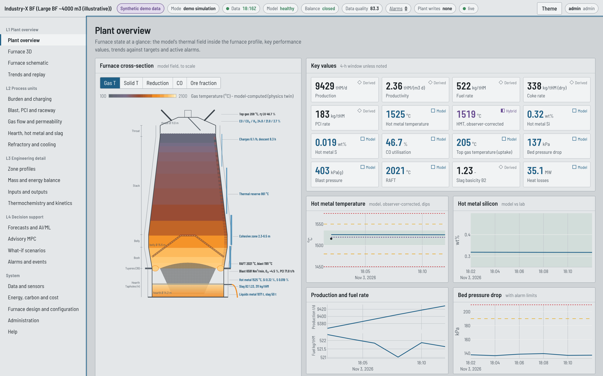

# Blast Furnace Digital Twin - operator desk (frontend)

Extractmet Private Limited. Browser desk for the blast-furnace digital twin: HTML, CSS and
JavaScript modules with Three.js (3-D furnace) and Plotly (charts), built by Vite into a static
site. It talks only to the backend API (`blast-furnace-backend`).

> Demonstration build. All values come from a **synthetic** plant and the physics twin; the
> desk labels every value as model, measured, hybrid or derived. Recommendations are advisory;
> nothing is sent to plant systems.



## Displays (ISA-101 hierarchy)

- **L1** Plant overview, Furnace 3D (cut-away with model fields, layers, cohesive zone, raceways,
  hearth liquids), to-scale furnace schematic with dimensions and lining, trends and replay.
- **L2** Burden and charging; blast, PCI and raceway; gas flow and permeability; hearth, hot metal
  and slag; refractory and cooling.
- **L3** Zone profiles (Baur-Glaessner path, Rist diagram), mass and energy balance (Sankey),
  inputs and outputs (weights, compositions, cumulative tonnages), thermochemistry and kinetics.
- **L4** Forecasts and AI/ML, advisory MPC, what-if scenarios (19 library cases, custom,
  comparison, sensitivity, Pareto), alarms and events.
- **System** Data and sensors, energy/carbon/cost, furnace design and configuration (presets,
  dimensions, refractory lining), administration, help.

## Run locally

```bash
npm ci
echo "VITE_API_BASE_URL=http://localhost:8000" > .env.local     # backend URL, no trailing slash
npm run dev            # http://localhost:5173
npm test               # vitest unit and display smoke tests (npm run coverage for coverage)
npm run build          # static site in dist/
```

Node.js 22 (see `.node-version`). `.npmrc` sets `legacy-peer-deps` so that `npm ci` reproduces the
committed lockfile exactly.

## Deploy on Render

`render.yaml` is a Render Blueprint for a static site: **New > Blueprint**, pick this repository,
set `VITE_API_BASE_URL` to the backend URL. The value is compiled into the bundle at build time
(it is not a secret; never put secrets in `VITE_*` variables). Full steps:
[docs/BLAST_FURNACE_DEPLOYMENT_GUIDE.md](docs/BLAST_FURNACE_DEPLOYMENT_GUIDE.md).

## Structure

```
index.html          shell: status strip, navigation rail, main area
src/main.js         router, status strip, sign-in, theme, live stream
src/lib/            api client (auth, errors, jobs, WebSocket + polling), UI helpers, charts, store
src/viz/            schematic.js (2-D section, SVG), furnace3d.js (Three.js)
src/pages/          22 displays
src/styles.css      day and night themes, layout, components
tests/              vitest + jsdom; fixtures are API payloads recorded from the backend (synthetic data)
.github/workflows/  CI: tests with coverage, build, npm audit
docs/               user guide with screenshots, test results, deployment guide
```

## Documentation

- [docs/USER_GUIDE.md](docs/USER_GUIDE.md) - every display, with screenshots
- [docs/TEST_RESULTS.md](docs/TEST_RESULTS.md) - test and build results
- [docs/UAT_CHECKLIST.md](docs/UAT_CHECKLIST.md) - manual acceptance checklist for a demonstration or pilot
- [docs/BLAST_FURNACE_DEPLOYMENT_GUIDE.md](docs/BLAST_FURNACE_DEPLOYMENT_GUIDE.md) - GitHub and Render deployment
- [CHANGELOG.md](CHANGELOG.md), [LICENSE](LICENSE), [THIRD_PARTY_NOTICES.md](THIRD_PARTY_NOTICES.md)
