# User guide - operator and engineer desk

The desk shows the blast furnace as the physics twin sees it, the measurements it is compared
with, forecasts and advisory recommendations. In this build every value comes from a
**synthetic** plant; the purple *Synthetic demo data* chip at the top says so on every screen.

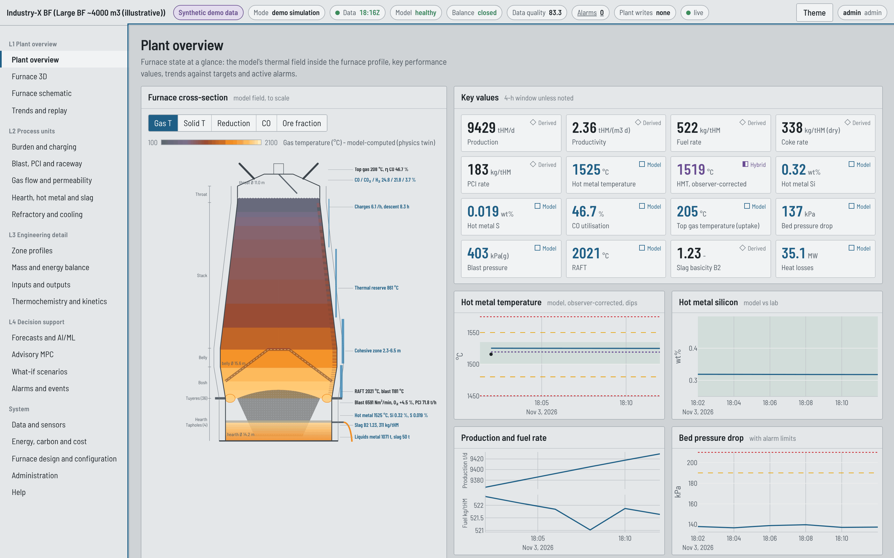

## 1. Layout

- **Status strip** (top): plant and preset, data origin, operating mode, data clock (green when
  fresh), model health, balance closure, data-quality score, active alarms, *Plant writes none*,
  stream state (*live* = WebSocket, *polling* = fallback), theme switch, sign-in.
- **Navigation rail** (left), grouped by the ISA-101 display hierarchy: L1 plant overview,
  L2 process units, L3 engineering detail, L4 decision support, then system pages.
- **Value marks** on every tile: *Model* (computed by the twin), *Measured* (sensor or lab),
  *Hybrid* (physics combined with data - observer correction or a promoted ML correction),
  *Derived* (calculated from other values), *Proxy* (indicator). A model value is never
  presented as a measurement.
- **Colour**: grey is normal. Amber outline = alarm limit crossed, red = hard limit crossed.
  Orange-to-yellow is reserved for heat and molten material.
- **Theme**: day and night-shift palettes (*Theme* button).

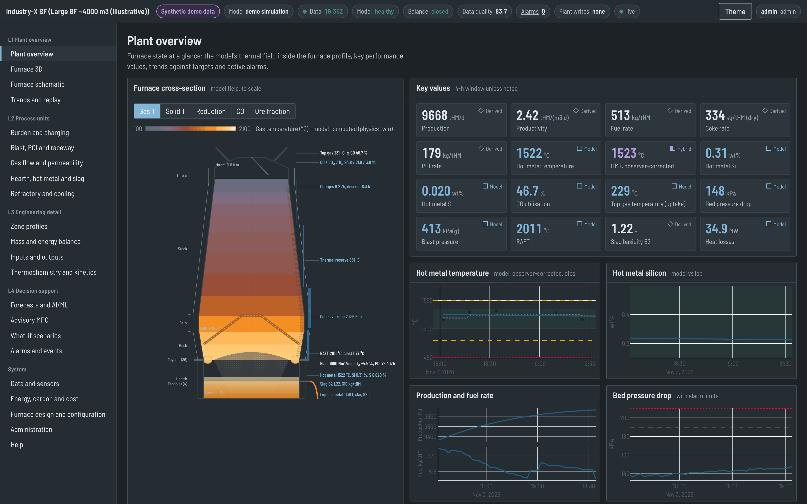

## 2. L1 - Plant overview

| Display | What it shows |
|---|---|
| Plant overview | key tiles (HMT, Si, production, fuel rate, RAFT, eta CO, dP, top gas, heat loss), the to-scale schematic with model field and value tags, 24 h trends with targets and limits, active alarms |
| Furnace 3D | cut-away furnace built from the configured geometry: field on the section plane (gas T, solids T, reduction, CO, H2, gas velocity, softening), burden layers, cohesive zone, deadman, metal and slag pools, raceways at every tuyere, stave heat loads |
| Furnace schematic | full-size labelled cross-section with dimensions, regions, lining and cooling zones, and every value placed where it belongs; dimension and lining tables |
| Trends and replay | measured tags as received (with quality) and any twin variable as small multiples, 48 h |

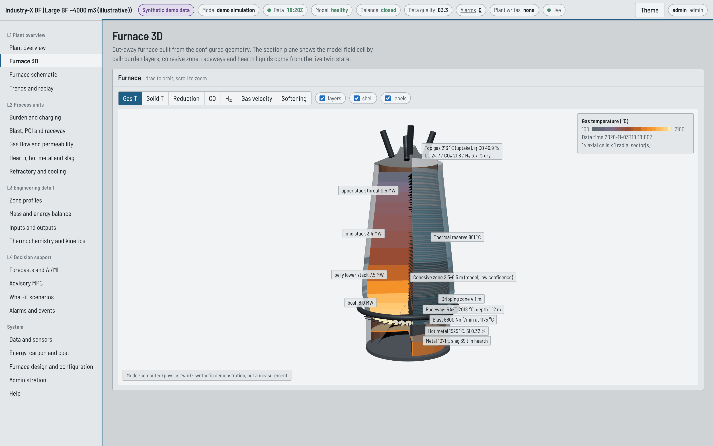

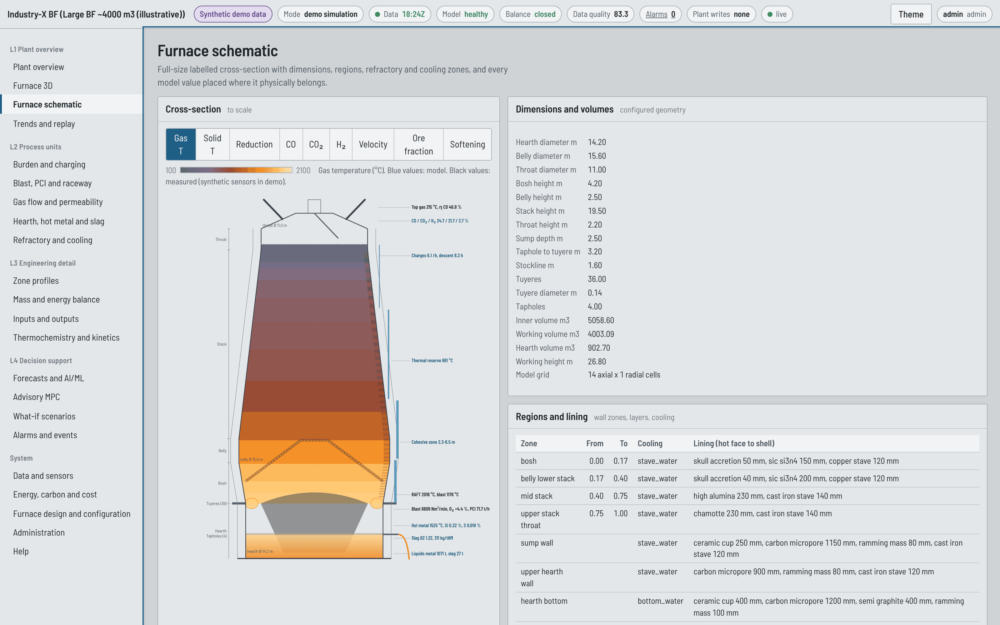

## 3. L2 - Process units

| Display | Content |
|---|---|
| Burden and charging | charge matrix, ore mix, coke and ore batches, layer structure, descent time, demo setpoint form |
| Blast, PCI and raceway | blast conditions, oxygen and PCI rates, RAFT, raceway depth, bosh gas, tuyere velocity and kinetic energy, trends |
| Gas flow and permeability | pressure profile, gas composition along the height, velocity and cell dP, top gas analysis, permeability and resistance indices, flooding and fluidisation risk proxies |
| Hearth, hot metal and slag | liquid levels against tapholes and tuyeres, casting log, hot-metal and slag chemistry, lab results at their sampling time |
| Refractory and cooling | temperature through every lining layer, stave heat loads by zone, measured thermocouples, 1150 degC isotherm position in the hearth (a remaining-lining proxy, not a life prediction) |

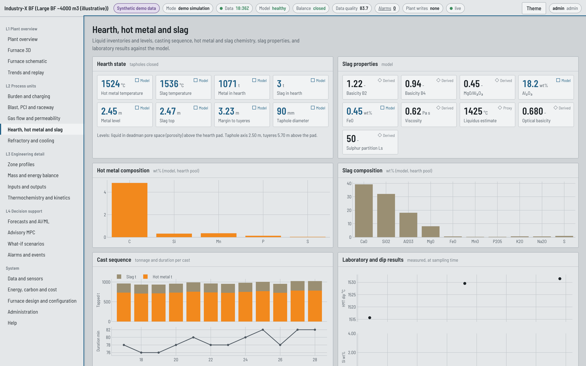

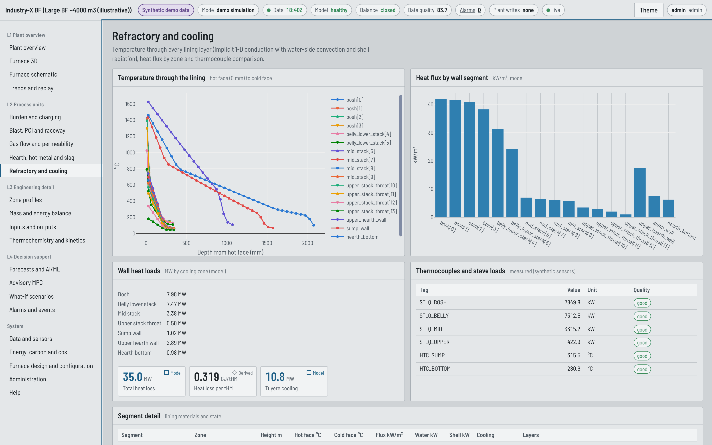

## 4. L3 - Engineering detail

| Display | Content |
|---|---|
| Zone profiles | axial temperatures, reduction degree, gas composition, reaction rates, heat exchange, Baur-Glaessner path and Rist diagram |
| Mass and energy balance | element balance table (in, out, accumulation, residual), energy balance, conventional heat balance with Sankey diagram, residual history |
| Inputs and outputs | weights and compositions of every input (sinter, pellet, lump, coke, PCI, blast) and output (hot metal, slag, top gas, dust) per hour and per tHM, cumulative tonnages; CSV/XLSX export |
| Thermochemistry and kinetics | reaction catalogue with enthalpies and equilibrium constants, kinetic parameters, Ellingham and Baur-Glaessner diagrams |

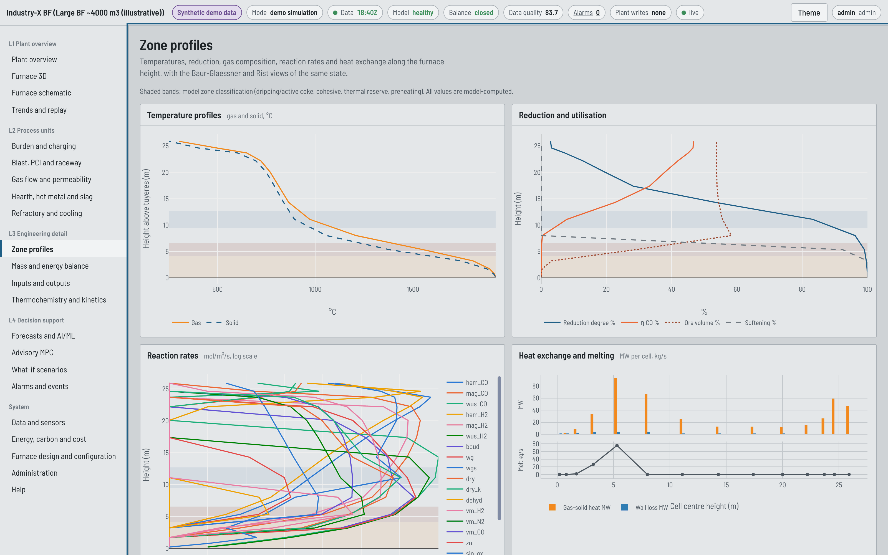

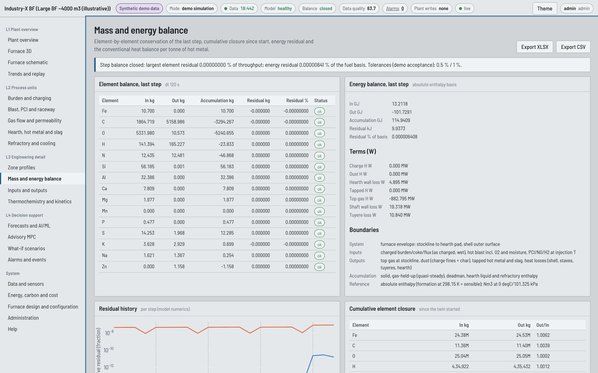

## 5. L4 - Decision support

### Forecasts and AI/ML

**Run forecast** clones the twin and runs it forward at the current settings for 1, 2, 4 and 8
hours, adds the observer bias and, where a model exists, shows the ML residual model's value. A
model replaces the physics + observer forecast only if it beat both baselines on its held-out
test block; otherwise its value is shown as *ML shadow*. The registry lists data origin, rows,
metrics against baselines and approval status (*not approved for plant use* for every demo
model).

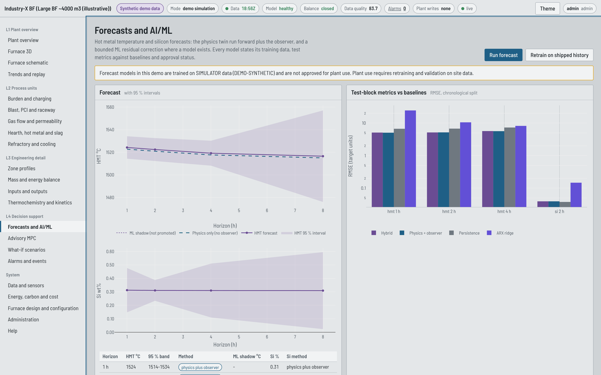

### Advisory MPC

1. Sign in as operator or higher.
2. Set the HMT target (default: middle of the target window). Leave the Si field blank to keep
   Si inside its window (zone control), or enter a value to make it a setpoint.
3. Choose the levers the optimiser may use (coke batch is off by default) and, if wanted, an
   economic weight.
4. **Compute advisory**. The result shows the trust-gate checks, the moves per block with
   limits, an explanation, solver status, and the predicted trajectories: free response, with
   the proposed moves (ROM), and the independent physics re-simulation.
5. **Acknowledge** or **Reject** with a comment. This records your decision in the audit trail
   and nothing else. Any change is made on the DCS by the operator under site procedures.

A recommendation is valid for 30 minutes. If any trust-gate check fails you get
*advice suppressed* with the reasons; if the limits cannot all be met you get *no feasible
solution* and no moves.

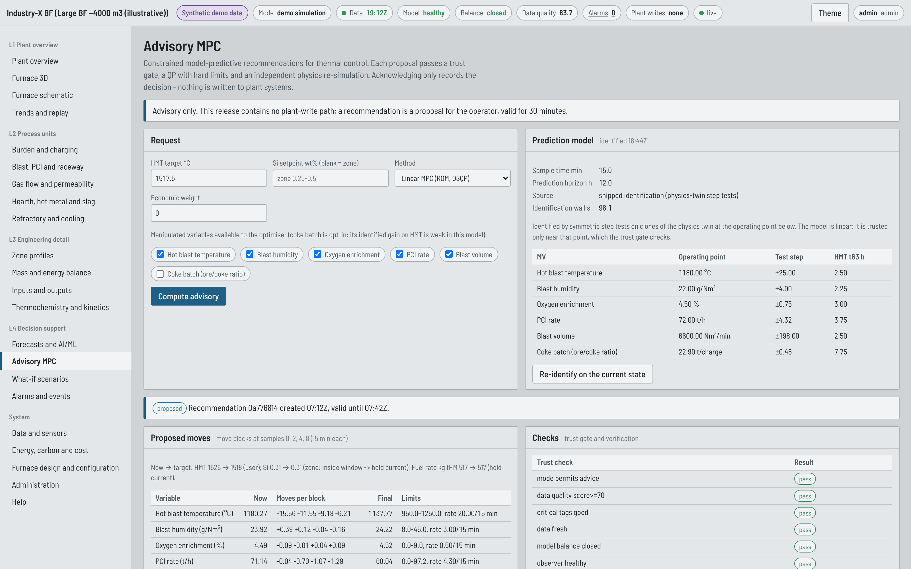

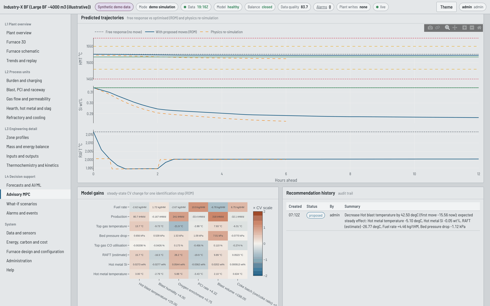

### What-if scenarios

Run any of the 19 library scenarios (coke rate, PCI with and without oxygen, hot blast, oxygen,
moisture, blast volume, pellet share, HBI, lower-grade sinter, coke quality, permeability,
delayed tapping, instrument faults, stove change and tuyere closures, cost Pareto, infeasible
limits, thermal instability) or build a custom one from timed setpoint changes. Every case runs
on a clone of the live twin against a baseline from the same state. Results: trajectories of
any KPI, final deltas, cumulative inputs and outputs, end-of-run compositions, and downloads
(CSV of trajectories, full JSON). **Compare** runs up to six scenarios against one baseline;
**Sensitivity** shows tornado charts from the ROM (instant) or the physics twin (job).

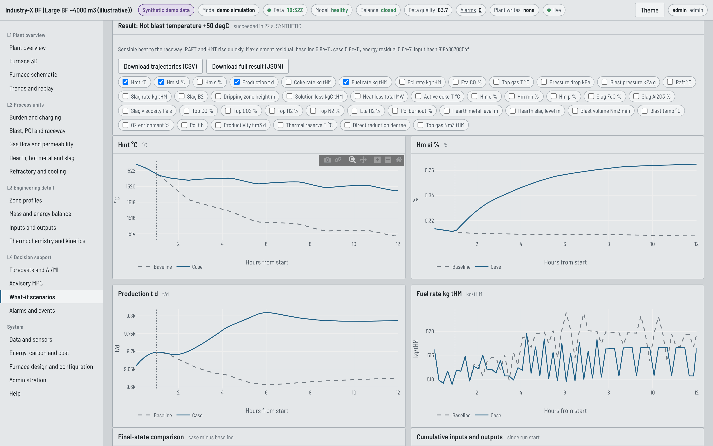

### Alarms and events

Active alarms with their evidence and *possible* causes, acknowledgement (operator), detection
rules, counts, timeline and the system event log. This list is advisory and is not part of any
safety function.

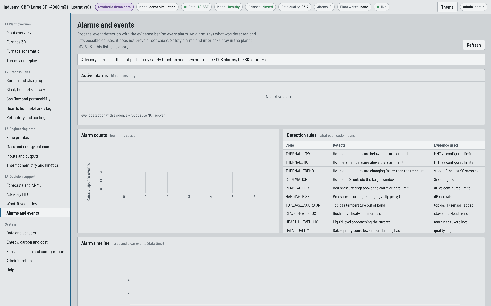

## 6. System pages

| Display | Content |
|---|---|
| Data and sensors | data source and mode, data-quality score and per-tag quality with reasons, observer parameters and reconciliation, demo fault injection, historian upload, tag catalogue and site mapping, tag trends |
| Energy, carbon and cost | heat supply and demand, energy intensity by carrier, wall heat loss by zone, top gas, CO2 by boundary (model estimate), variable cost breakdown |
| Furnace design and configuration | size presets, dimensions, operating point, refractory lining editor with a planar flux check, configuration versions (*Load* puts an earlier version into the editor for roll-back), full JSON with validation (process engineer) |
| Administration | system status, session and demo accounts, safety case, service endpoints, jobs, audit trail (admin) |
| Help | reading the displays, workflow, model scope, glossary |

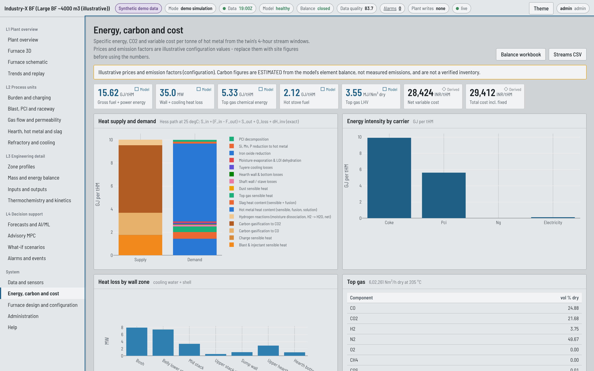

## 7. Exports

Every export carries a header with data origin (*SYNTHETIC* in this build), configuration and
model version, UTC time, input hash and units. Exports are available on the Inputs and outputs,
Mass and energy balance, Energy, Data and sensors and What-if pages.

## 8. Phone and tablet

The desk is usable on a phone for monitoring (single column, wrapping status strip). The 3-D
view and wide tables are designed for desktop screens.

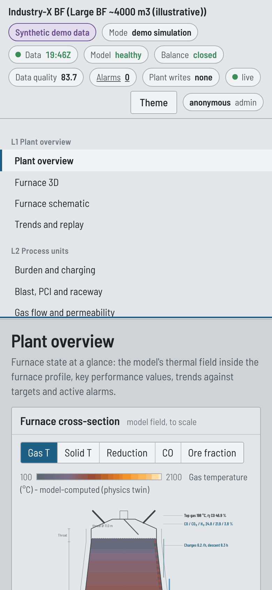
